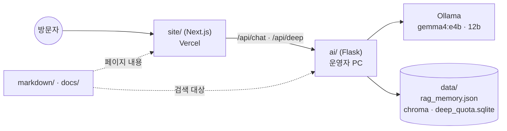

# Portfolio — 컷앤킵 설명 사이트

> 컷앤킵이 **무엇이고, 어떻게 만들었고, 어디까지 되었는지**를 읽는 별도 사이트와 그 원고.

이 폴더는 제품이 아니다. 컷앤킵(Cut & Keep)을 설명하는 **문서**와, 그 문서를 읽는 **전용 사이트**, 그리고 문서로 답하는 **AI 안내 챗**을 둔다.
기능을 다시 구현하지 않고, 이미 저장소와 운영 서버에 있는 구성을 역할별로 짧게 보여 준다.

| 항목 | 내용 |
|------|------|
| 공개 주소 | https://cutnkeep-portfolio.vercel.app |
| 화면 | [`site/`](site/README.md) — Next.js 15 · React 19, 로컬 http://127.0.0.1:5190 |
| AI 안내 | [`ai/`](ai/README.md) — Flask · LangGraph · LangChain · Ollama, 로컬 http://127.0.0.1:5055 |
| 원고 | [`markdown/`](markdown/) — 9개 장 + Word 한 권 |
| 기준일 | 2026-10-12 인수인계. 기능 정본은 [`docs/FEATURES.md`](../docs/FEATURES.md), 운영 상태는 [`docs/HANDOVER.md`](../docs/HANDOVER.md) |

**제품 코드(`frontend/` · `console/` · `backend/`)와 운영 서버는 이 폴더에서 바꾸지 않는다.**

---

## 1. 왜 따로 만들었나

컷앤킵 자체는 사진을 처리하는 서비스라, 그 화면만 봐서는 내부 구조 · 설계 이유 · 실험 수치 · 한계를 알 수 없다.
이 사이트는 그 빈칸을 채운다.

- 채용 담당자나 면접관이 **5분 안에** 프로젝트의 범위와 수준을 파악할 수 있게 한다.
- 다음 담당자가 장별로 필요한 부분만 골라 읽을 수 있게 한다.
- 문서에 없는 것을 지어내지 않는다. 안내 챗도 문서에 있는 대로만 답한다.

읽는 순서는 이렇다.

1. 홈(소개)에서 제품이 무엇인지 본다.
2. 사용자 앱 · 운영 콘솔 · 백엔드 · AI 서비스 중 필요한 장으로 들어간다.
3. 데이터 구조가 필요하면 ERD와 스프레드시트를 본다.
4. 문장으로 더 묻고 싶으면 안내 챗을 연다.

---

## 2. 구성



| 경로 | 역할 |
|------|------|
| `site/` | Next.js. 장별 화면과 이 사이트의 API(`/api/chat` · `/api/deep`) |
| `ai/` | Flask. 이 포트폴리오를 설명하는 AI 안내. **제품 백엔드와 별도** — 사진을 처리하지 않고 제품 DB에 연결하지 않는다 |
| `markdown/` | 사이트와 안내 챗의 원고 |
| `assets/` | 스프레드시트 JSON · ERD 원본 |
| `CutNKeep_Portfolio.docx` | 원고를 한 권으로 묶은 Word 문서 |

### 제품과 이 사이트의 차이

| | 컷앤킵 제품 | 이 설명 사이트 |
|--|-------------|----------------|
| 화면 | React(Vite) 사용자 앱 + React 운영 콘솔 | Next.js |
| 서버 | FastAPI (사진 · 영상 처리) | Flask (문서로 답하는 안내만) |
| 챗 | 제품 AI 채팅 — **요청 문장을 만들어 주는** 기능 (`POST /api/v1/chat`) | 안내 챗 — **이 프로젝트를 설명하는** 기능 |
| 데이터 | MariaDB 서비스 DB · 학습 DB | JSON · Chroma · SQLite(깊이 추론 횟수만) |

두 챗은 프로세스도 목적도 다르다. 안내 챗이 제품의 기본 해석 모델(`gemma4:e4b`) 설정을 바꾸지 않는다.

---

## 3. 원고

| 파일 | 내용 |
|------|------|
| [markdown/01-overview.md](markdown/01-overview.md) | 사이트 소개 · 목차 · 프로젝트와 기능 요약 · 숫자로 확인된 것 · 지금 한계 |
| [markdown/02-frontend.md](markdown/02-frontend.md) | 사용자 앱 — 엔진 · 화면 · API 연결 · 디자인 · 문제와 개선 |
| [markdown/03-console.md](markdown/03-console.md) | 운영 콘솔 — 접근 규칙 · 검수가 막는 것 · 회원 관리 |
| [markdown/04-backend.md](markdown/04-backend.md) | FastAPI 서버 — 계층 · 파이프라인 · API · 보관 · 보안 · 한계 |
| [markdown/05-ai.md](markdown/05-ai.md) | 비전 · 문장 해석 · RAG · LoRA · 학습 · 이 사이트의 안내 챗 |
| [markdown/06-project.md](markdown/06-project.md) | 사업 · 업무 관점의 프로젝트 소개 — 누구를 위한가 · 맡은 일 · 다음 업무 |
| [markdown/07-terms.md](markdown/07-terms.md) | 이 포트폴리오 사이트의 이용약관 |
| [markdown/08-erd.md](markdown/08-erd.md) | 2026-10-11 ERD와 그 이후 생긴 테이블 |
| [markdown/09-spreadsheet.md](markdown/09-spreadsheet.md) | Scribble 통합 스프레드시트 10개 시트 (기능 · URL · 화면 · 일정 · 이후 계획) |
| [CutNKeep_Portfolio.docx](CutNKeep_Portfolio.docx) | 위 문서를 한 권으로 묶은 Word 문서 |

원본 스프레드시트(xlsx)와 ERD HTML은 로컬 `Scribble/`에만 있고 Git에 올라가지 않는다. 같은 내용을 이 폴더로 옮겨 두었다.

| 경로 | 내용 |
|------|------|
| `assets/spreadsheet.json` | 시트 전체 — `/data/spreadsheet` 화면이 빌드 때 읽는다 |
| `assets/erd/cutnkeep_erd_2026-10-11.html` | ERD 원본 HTML (표와 까마귀발 선을 스크립트로 그림) |
| `assets/erd/cutnkeep_erd_2026-10-11.png` | ERD 그림 |

원고를 고칠 때의 원칙:

- 수치는 실험 · 운영 기록에 있는 것만 쓴다. "모든 입력에 대한 보장이 아님"을 함께 적는다.
- 되지 않은 일은 되었다고 적지 않는다. 한계는 숨기지 않고 장마다 적는다.
- 회원 개인정보가 보이는 캡처는 넣지 않는다.

---

## 4. 안내 챗

사이트의 `/chat`에서 이 프로젝트에 대해 질문하면, Flask 안내가 원고와 핵심 제품 문서를 검색해 답한다.

| 항목 | 내용 |
|------|------|
| 흐름 | LangGraph — 질문 이해 → 문서 검색 + 배운 대화 검색 → 초안 → 필요하면 수정 → 학습 저장 |
| 검색 | 문서 BM25 + 글자 2-gram + `ai/data/chroma`의 문서 벡터 + 배운 대화. **임베딩 모델을 받지 않는다** |
| 모델 | 기본 Ollama `gemma4:e4b`. 보내기 위 버튼으로 높은 모델 `gemma4:12b`를 **고르기만** 한다 (그 버튼은 전송하지 않는다) |
| 깊이 추론 | 입력창의 뇌 버튼을 선택한 뒤 보내면 검색 개수 · 문서 글자 · 생성 길이를 2.5배로 한다. **사이트 전체로 하루 10번**, 한국 시간 오전 12시에 초기화 |
| 대화 기록 | 브라우저 `localStorage`에만. 대화 본문용 DB는 없다 |
| 학습 | 답이 문서에 맞게 나오면 질문 · 비슷한 질문 · 답을 `ai/data/rag_memory.json`과 `ai/data/chroma`에 남겨 다음 비슷한 질문의 보완 예시로 쓴다. 예시와 문서가 다르면 문서를 따른다 |

깊이 추론 횟수의 규칙:

- 횟수는 `ai/data/deep_quota.sqlite`의 표 `deep_day`(`kst_date`, `used`)에만 있다. 브라우저와 사이트 함수 디스크에는 저장하지 않는다.
- 보내면 화면의 남은 횟수가 바로 줄고, 안내 서비스가 요청을 받은 뒤에는 답이 실패해도 되돌리지 않는다.
- 한국 시간 날짜가 바뀌기 전에는 10으로 다시 채우지 않는다. 날짜는 `ZoneInfo`가 아니라 UTC+9로 계산한다 (안내 가상환경에 tzdata가 없기 때문).
- 안내에 닿지 않으면 남은 횟수를 10으로 만들지 않는다.
- 남은 횟수가 0이면 뇌 버튼은 눌리지 않고, 마우스를 올리면 `토큰 횟수가 전부 떨어졌으니 자정때 까지 기다려주시길 바랍니다.`가 나온다.

---

## 5. 로컬 실행

두 프로그램을 각각 띄운다. 안내 기본 모델 `gemma4:e4b`가 없으면 챗만 멈추고 페이지는 열린다.

```bash
# 1) AI 안내 (Flask, :5055)
cd Portfolio/ai
python -m venv .venv
.venv/Scripts/pip install -r requirements.txt
.venv/Scripts/python app.py

# 2) 화면 (Next.js, :5190)
cd Portfolio/site
npm install
npm run dev
```

Ollama에는 `ollama pull gemma4:e4b`(필수)와 `ollama pull gemma4:12b`(선택)가 있어야 한다.

---

## 6. 공개 배포 (2026-10-12 기준)

```text
방문자 ─▶ Vercel (Portfolio/site) ─ /api/chat · /api/deep ─▶ Cloudflare 임시 터널 ─▶ 운영자 PC의 Flask (Portfolio/ai) ─▶ PC의 Ollama
```

| 대상 | 배포 | 메모 |
|------|------|------|
| `site/` | **Vercel** 프로젝트 `cutnkeep-portfolio` | Root Directory `Portfolio/site`, Node 22.x, "루트 밖 파일 포함" 켬 (`../assets/spreadsheet.json` 때문). Git 자동 배포 대신 CLI로 올린다 |
| `ai/` | **운영자 PC** + `cloudflared tunnel --url http://127.0.0.1:<포트>` | Render 무료 서버에는 `gemma4:12b`를 올릴 수 없어 쓰지 않는다 |

### 다시 배포하는 순서

```bash
# 1) PC 에서 Ollama 를 켠 뒤 안내 서버를 띄운다 (5055 를 다른 프로그램이 쓰면 다른 포트로)
cd Portfolio/ai && PORT=5877 .venv/Scripts/python app.py

# 2) 다른 터미널에서 임시 터널 — 출력되는 https://....trycloudflare.com 주소를 복사한다
cloudflared tunnel --no-autoupdate --url http://127.0.0.1:5877

# 3) Vercel 환경변수를 그 주소로 바꾸고 다시 배포
npx vercel env rm PORTFOLIO_AI_URL production --yes --scope <팀>
npx vercel env add PORTFOLIO_AI_URL production --scope <팀>      # 값: 터널 주소
npx vercel deploy --prod --yes --scope <팀>
```

- 저장소 전체를 올리면 파일이 3만 개가 넘어 느리다. `Portfolio/site`(`node_modules` · `.next` · `site/data` 제외)와 `Portfolio/assets`만 같은 구조로 임시 폴더에 복사해서 그 폴더에서 배포한다. **`app/data`(ERD · 시트 화면)는 빼지 않는다.**
- Vercel Hobby 플랜은 함수 실행이 최대 300초라 `api/chat`의 `maxDuration`은 300이다.
- 확인: `https://cutnkeep-portfolio.vercel.app/api/chat`(GET)이 `"ready": true`, 페이지 10개가 200.

### 알아둘 점

- 챗은 **PC가 켜져 있고** Flask와 cloudflared가 떠 있을 때만 동작한다. 꺼지면 챗만 연결 실패가 나고 나머지 페이지는 그대로 열린다.
- 임시 터널 주소는 cloudflared를 다시 켜면 바뀐다. 그때마다 환경변수 교체와 재배포가 필요하다. 고정 주소가 필요하면 Cloudflare에 등록된 도메인과 이름 있는 터널을 쓴다. 임시 터널은 Cloudflare 대시보드에 나타나지 않는다.
- 터널 주소를 아는 사람은 PC의 안내 서버에 직접 질문을 보낼 수 있다.

배포 기록: [`docs/branchs/commits/261012_1757_600bd68_portfolio-deploy-duration_feature-portfolio-deploy.md`](../docs/branchs/commits/261012_1757_600bd68_portfolio-deploy-duration_feature-portfolio-deploy.md)
