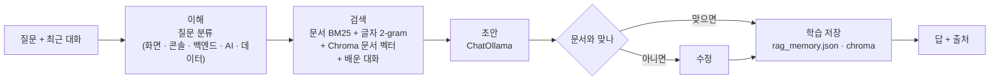

# Portfolio/ai — 포트폴리오 AI 안내 (Flask)

> 포트폴리오 원고와 핵심 제품 문서를 검색해서, 이 프로젝트에 대한 질문에 **문서에 있는 대로만** 답하는 작은 서버.

설명 사이트([`../site/`](../site/README.md))의 안내 챗이 이 서버를 부른다.
제품 FastAPI([`backend/`](../../backend/README.md))와는 **완전히 별도**다. 사진을 처리하지 않고, 제품 데이터베이스에 연결하지 않는다.

| 항목 | 내용 |
|------|------|
| 주소 | http://127.0.0.1:5055 (`PORT`로 변경) |
| 기술 | Flask 3.1 · LangGraph 0.6 · LangChain 0.3 (`langchain-ollama`) · rank-bm25 · Chroma 1.5 |
| 모델 | Ollama — 기본 `gemma4:e4b`, 선택 `gemma4:12b` |
| 저장 | `data/rag_memory.json` · `data/chroma/` · `data/deep_quota.sqlite` (모두 이 폴더 안, Git 제외) |
| 테스트 | `test_chroma_store.py` · `test_deep_quota.py` · `test_guide_model.py` |

---

## 1. 답을 만드는 과정



- **LangGraph**가 이해 → 검색 → 초안 → 필요하면 수정 → 학습 저장의 상태를 관리한다.
- **LangChain**으로 `ChatPromptTemplate` · `StrOutputParser` · `ChatOllama` · 문서 검색기 · 비슷한 질문 생성을 묶는다.
- 질문은 키워드로 프론트 · 콘솔 · 백엔드 · AI · 데이터 중 한 갈래로 분류하고, 그 갈래의 원고에 검색 가산점을 준다. 다른 문서를 빼지는 않는다.
- 점수는 BM25 · 글자 2-gram 겹침 · 제목 겹침 · 구절 일치를 섞어 매긴다.

### 검색 대상

| 대상 | 경로 |
|------|------|
| 포트폴리오 원고 | `Portfolio/markdown/*.md` |
| 핵심 제품 문서 | `docs/HANDOVER.md` · `docs/FEATURES.md` · `docs/WORKFLOW.md` |
| 문서 벡터 | `data/chroma`의 컬렉션 `guide_docs` (문서가 바뀌면 다시 맞춤) |
| 배운 대화 | `data/rag_memory.json` + `data/chroma`의 `guide_memory` |

**임베딩 모델을 따로 받지 않는다.** 한글 글자 조각을 해싱한 벡터(`chroma_embed.py`)를 쓴다. 예시와 문서가 다르면 문서를 따른다.

### 학습

답이 문서에 맞게 나오면 질문 · 비슷한 질문 · 답을 `data/rag_memory.json`과 `data/chroma`에 남긴다. 다음 비슷한 질문의 **보완 예시로만** 쓴다.
화면의 대화 목록은 여기 없다 — 브라우저 `localStorage`가 가지고, 요청마다 최근 대화(최대 8개)를 다시 보낸다.

### 모델 설정

| 구분 | 설정 |
|------|------|
| 일반 답 | 생각 토큰 끔 · 문맥 6144 · 생성 800 |
| 깊이 추론 (`deep: true`) | 검색 개수 · 문서 글자 · 생성 길이를 **2.5배**. 생각 토큰은 켜지 않는다 — 켜면 그 한도를 생각만 쓰고 보이는 답이 비기 때문 |
| 모델 선택 (`model`) | `gemma4:e4b`(기본) 또는 `gemma4:12b`. 고른 모델이 없으면 그 요청만 503으로 알린다 |

이 서비스가 제품의 기본 해석 모델 설정을 바꾸지는 않는다.

---

## 2. 깊이 추론 횟수

사이트 전체로 **하루 10번**이다. 이 서버가 센다 (`deep_quota.py`).

- 저장: `data/deep_quota.sqlite`의 표 `deep_day`(`kst_date`, `used`). 예전 표 `deep_uses`는 옮길 때만 읽는다.
- 날짜: UTC+9로 계산한다 (`ZoneInfo("Asia/Seoul")`가 아님 — 이 가상환경에 tzdata가 없다).
- 한국 시간 날짜가 바뀌기 전에는 줄인 횟수를 되돌리지 않는다.
- 요청을 받으면 바로 줄이고, 답이 실패해도 되돌리지 않는다.
- 고른 모델이 없거나 질문이 아니면 **횟수를 줄이기 전에** 거절한다.
- 한도를 넘으면 429와 남은 횟수를 돌려준다.

---

## 3. API

| 경로 | 설명 |
|------|------|
| `GET /health` | Ollama 연결과 모델 설치 여부. 기본 모델이 있으면 200, 없으면 503. `models`에 모델별 설치 여부 |
| `GET /v1/deep` | 오늘의 깊이 추론 횟수 (`limit` · `used` · `remaining` · `date`) |
| `POST /v1/guide` | 질문. 본문 `{ "messages": [...], "model": "gemma4:e4b", "deep": false }` → `{ "answer", "sources", "quota"? }` |

```bash
curl http://127.0.0.1:5055/health
curl -X POST http://127.0.0.1:5055/v1/guide -H "content-type: application/json" \
     --data-binary @question.json      # {"messages":[{"role":"user","content":"컷앤킵이 뭐야?"}]}
```

Windows 셸에서 한글 JSON을 `curl -d`로 직접 보내면 깨진다. UTF-8 파일을 `--data-binary @파일`로 보낸다.

| 응답 | 뜻 |
|------|----|
| 400 | `messages`가 없거나 마지막 메시지가 사용자 질문이 아님 |
| 429 | 깊이 추론 하루 한도 초과 |
| 502 | 모델 호출 실패 |
| 503 | Ollama에 연결하지 못했거나 고른 모델이 없음 |

---

## 4. 실행

```bash
cd Portfolio/ai
python -m venv .venv
.venv/Scripts/pip install -r requirements.txt
.venv/Scripts/python app.py               # http://127.0.0.1:5055
```

| 환경변수 | 기본 | 설명 |
|----------|------|------|
| `PORT` | 5055 | 이 PC처럼 5055를 다른 프로그램이 쓰면 다른 포트로 (예: 5877) |
| `OLLAMA_BASE_URL` | `http://127.0.0.1:11434` | Ollama 주소 |
| `PORTFOLIO_CHROMA_DIR` | `data/chroma` | Chroma 위치 |
| `PORTFOLIO_RAG_MEMORY` | `data/rag_memory.json` | 배운 대화 파일 |

Ollama에 `gemma4:e4b`가 없으면 `/health`가 503이다. `gemma4:12b`가 없어도 기본 답은 된다.

서버는 `127.0.0.1`에만 열린다. 밖에서 쓰려면 Cloudflare 터널 같은 앞단을 둔다 → [`../README.md` 7절](../README.md#7-공개-배포-2026-10-12-기준)

### 테스트

```bash
.venv/Scripts/python -m pytest -q
```

---

## 5. 하지 않는 것

- 사진을 처리하지 않는다.
- 제품 데이터베이스(MariaDB · SQLite)에 연결하지 않는다.
- 대화 본문을 저장하지 않는다 (학습 예시만 남긴다).
- 문서에 없는 기능을 있다고 답하지 않는다.
