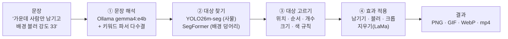
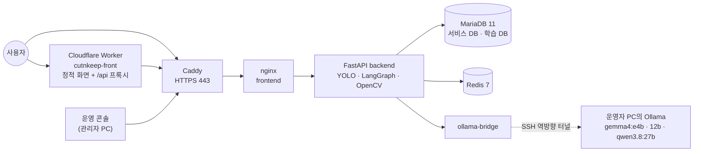
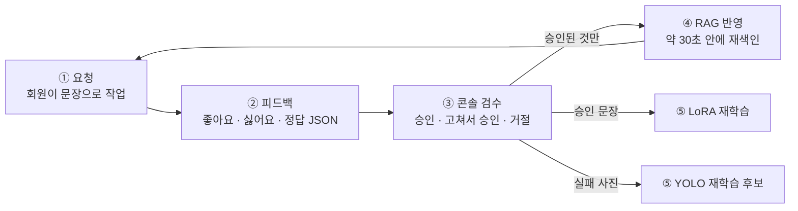

# 컷앤킵 (Cut & Keep)

> **말로 하면, 원하는 것만 남습니다.**
> 사진 · 움직이는 GIF · 짧은 영상을 올리고 한 문장으로 요청하면, 원하는 대상만 남기거나 필요 없는 대상을 지워 주는 웹 서비스.

```text
"강아지만 남기고 배경 제거"        → 강아지만 남은 투명 PNG
"맨 앞 빨간 안전모 쓴 사람만 남기고" → 여러 사람 중 그 한 명만
"오른쪽 사람 지워줘"              → 그 자리를 주변 무늬로 메운 사진
```

| 항목 | 내용 |
|------|------|
| 상태 | **공개 운영 중** (2026-10-11 실서버 배포 · 2026-10-12 인수인계) |
| 개발 | 1인 개발 · 2026-07-27 첫 커밋부터 약 11주 · 커밋 395건 (10-11 기준) |
| 구성 | 사용자 앱 · 운영 콘솔 · API 서버 · 학습 도구, 그리고 이 프로젝트를 설명하는 포트폴리오 사이트 |
| 서비스 | https://168-110-17-193.sslip.io · 화면(Cloudflare) https://cutnkeep-front.limjinheng0120.workers.dev |
| 설명 사이트 | https://cutnkeep-portfolio.vercel.app ([Portfolio/](./Portfolio/README.md)) |
| 테스트 | 백엔드 505 · 사용자 앱 95 · 콘솔 21 통과 (2026-10-12) · 서버 점검 실패 0 · 경고 0 |

---

## 목차

1. [왜 만들었나](#1-왜-만들었나)
2. [무엇을 할 수 있나](#2-무엇을-할-수-있나)
3. [어떻게 동작하나](#3-어떻게-동작하나)
4. [시스템 구성](#4-시스템-구성)
5. [기술 스택](#5-기술-스택)
6. [AI — 문장을 이해하는 방법](#6-ai--문장을-이해하는-방법)
7. [학습 순환 — 틀리면 가르친다](#7-학습-순환--틀리면-가르친다)
8. [데이터 · 보관 · 보안 원칙](#8-데이터--보관--보안-원칙)
9. [빠른 시작](#9-빠른-시작)
10. [저장소 구조](#10-저장소-구조)
11. [테스트](#11-테스트)
12. [문서 지도](#12-문서-지도)
13. [개발 방식](#13-개발-방식)
14. [진행 단계와 남은 일](#14-진행-단계와-남은-일)

---

## 1. 왜 만들었나

이미지에서 대상을 가려 내는 일은 생각보다 손이 많이 간다.

- 학습 데이터를 만들 때 수천 장에 **사각형(바운딩 박스)** 을 일일이 두르는 작업은 느리다.
- 사각형은 물체의 **가장자리**를 담지 못한다. 배경이 섞이거나 대상이 잘린다.
- 일반 편집 앱으로 깔끔하게 오려 내려면 펜 도구와 레이어를 다룰 줄 알아야 한다.

컷앤킵은 이 일을 **한국어 한 문장**으로 줄인다. "이것만 남기고", "저것만 지우고"라고 말하면 서버가 문장을 구조화된 명령으로 해석하고, 대상을 **픽셀 단위 마스크**로 나눠 그 영역에만 효과를 적용한다.

해석이 틀리면 사용자가 정답을 알려 줄 수 있고, 운영자가 검수한 정답은 다음 해석의 **예시**가 된다. 문장으로 고르고 → 틀리면 고치고 → 고친 것이 다음 답을 바꾸는 순환이 이 프로젝트의 핵심이다.

| 누가 | 얻는 것 |
|------|---------|
| 이미지를 급히 갈라 내야 하는 사람 | 가입 없이 처리하고 바로 내려받기 (서버에 남기지 않음) |
| 작업을 다시 봐야 하는 회원 | 24시간 작업 기록 · 평가 · 정답 알려주기 · 배치 최대 500장 |
| 모델을 고치는 운영자 | 운영 콘솔 검수 · 재학습 스크립트 · 실험 기록 |
| 다음 담당자 | [`docs/HANDOVER.md`](docs/HANDOVER.md) 한 장으로 서버와 규칙 파악 |

일반 편집 앱의 모든 기능을 대체하려는 것은 아니다. **문장으로 대상을 고르는 일**에 집중한다.

---

## 2. 무엇을 할 수 있나

| 기능 | 예시 문장 | 결과 |
|------|-----------|------|
| 원하는 것만 남기기 | "강아지만 남기고 배경 제거" | 투명 PNG (배경 블러 · 크롭도) |
| 특정 한 명 · 하나 고르기 | "맨 앞 빨간 안전모 쓴 사람만", "왼쪽에서 두 번째 사람" | 위치 · 순서 · 개수 · 크기 · 색으로 고름 |
| 필요 없는 것 지우기 | "오른쪽 사람 지워줘" | 학습형 인페인팅(**LaMa**)으로 주변 무늬를 이어 그려 메움 |
| 배경 덩어리 | "건물만 남기고 하늘 블러" | 건물 · 하늘 · 도로 등 14종 (SegFormer) |
| **움직이는 GIF** | 작업실 GIF 탭 | 프레임마다 처리, 투명 GIF(올릴 배경색에 맞춘 경계) + 부드러운 경계 WebP |
| **짧은 영상** | 영상 화면 (최대 20초 · 80MB) | H.264 mp4, 프레임 사이 흔들림 보정, 오디오 유지 |
| 영상 · GIF에서 고른 대상 따라가기 | "왼쪽 사람만" | 첫 프레임에서 고른 사람을 끝까지 (서로 지나가도 유지) |
| 영상 · GIF 지우기 | "지나가는 사람 지워줘" | 다른 프레임에서 보인 실제 배경으로 메움 (고정 · 천천히 움직이는 카메라) |
| 해석 모델 고르기 | 처리하기 옆 상자 | Ollama e4b · 12b · Qwen 3.8 27b, 서버에 없는 모델은 "미적용" |
| **에이전트에게 묻기 (AI 채팅)** | 프롬프트 가이드 → 에이전트에게 묻기 | 원하는 결과를 말하면 알맞은 요청 문장을 알려 주고 "작업실에서 써 보기" |
| 배치 (회원) | 같은 문장으로 최대 500장 | 진행률 · 항목별 결과 · zip으로 받기 |
| **내 계정 (회원)** | 헤더 프로필 → 내 계정 | 내 정보 · 작업 기록 · 보안(비밀번호 변경 · 전체 로그아웃) · 보관 · 탈퇴 |
| **이메일 인증 가입** | 가입하기 → 메일의 일련번호 | 8글자 일련번호 입력 → 가입 완료 (HTML 메일) |
| 운영 콘솔 (관리자) | `console/` | 전체 작업 · 배치 · 학습 데이터 검수 · 회원 관리 · 시스템 점검 |

입력은 JPEG · PNG · WebP 사진, 움직이는 GIF(최대 120프레임), 짧은 영상이다. 출력은 투명 PNG · JPEG · 투명 GIF와 WebP · H.264 mp4다.

**비로그인**은 처리하고 그 자리에서 내려받기만 한다. 원본과 결과를 서버에 남기지 않는다.
**회원** 파일은 서버에 24시간 보관한 뒤 자동으로 지운다.

---

## 3. 어떻게 동작하나

한 요청은 네 단계를 거친다.



**① 문장 해석** — 문장을 `ParsedPrompt` 라는 구조로 바꾼다. 실제 작업 하나의 해석 결과는 이렇다.

```json
{
  "target": ["person"],
  "effect": "blur",
  "intensity": 33,
  "crop": false,
  "selector": { "position": "center", "rank": null, "count": 1, "attributes": [] }
}
```

화면은 이 결과를 **"이렇게 이해했어요"** 칩(대상 · 위치 · 개수 · 효과)으로 보여 준다. 사용자는 AI가 문장을 어떻게 읽었는지 바로 확인할 수 있다.

**② 대상 찾기** — 사람 · 동물 · 사물은 YOLO26m-seg 인스턴스 마스크로, 건물 · 하늘 · 도로 같은 덩어리 배경은 SegFormer ADE20K로 나눈다.

**③ 대상 고르기** — 같은 종류가 여럿이면 선택자 규칙으로 고른다. 학습이 아니라 규칙이다. 고른 대상에 다른 인스턴스가 섞이지 않도록 다른 인스턴스 영역을 빼는 것이 기본이다.

**④ 효과 적용** — `remove_bg`(투명 배경) · `blur`(강도 0~100, 숫자가 없으면 15) · `crop` · `remove_object`(사진은 LaMa, 없으면 Telea). 영상과 GIF는 프레임마다 같은 규칙을 적용하고, 고른 대상은 프레임 사이로 따라간다.

이 흐름은 **LangGraph** 상태 기계다.

```text
prompt_analyzer → preprocessor → segmentor → validator → effect_applier → feedback_collector
                                     ▲            │
                                     └── 재시도 ───┘   (실패에 가까우면 조건을 바꿔 한 번 더, 더 나쁘면 첫 시도 유지)
```

검증 결과가 실패에 가까우면 전처리 조건을 반대로 하고 신뢰도 기준을 낮춰 한 번 더 찾는다. 더 나쁜 마스크가 나오면 첫 시도를 유지한다. 대상을 끝내 못 찾으면 속이지 않고 "요청한 대상을 찾지 못함"과 그때 보인 라벨을 알려 준다.

---

## 4. 시스템 구성



| 구성 | 내용 |
|------|------|
| 서버 | Oracle Cloud A1.Flex (ARM 4 OCPU · 24GB · Ubuntu 24.04), 브랜치 `main` |
| 공개 포트 | 22 · 80 · 443뿐. 백엔드 · MariaDB · Redis · Adminer는 루프백 |
| 화면 | Cloudflare Worker가 정적 파일을 주고 `/api` · `/health`만 서버로 넘긴다. 실제 사용자 IP는 `EDGE_SECRET`이 맞을 때만 믿는다 |
| 문장 해석 | 서버만으로 큰 언어 모델을 돌릴 수 없어 **운영자 PC의 Ollama**를 SSH 역방향 터널로 쓴다. 끊기면 키워드 파서로 내려가고 서비스는 계속된다 |
| 메일 | Gmail SMTP — 가입 인증 · 아이디 찾기 · 비밀번호 재설정만 |
| 백업 | MariaDB 덤프를 매일, 7일간 (같은 서버 디스크) |
| 운영 콘솔 | 공개 서버에 올리지 않는다. 관리자 PC에서 띄워 서버 API로 붙는다 |

로컬 개발에서는 세 앱이 각각 뜬다.

| 앱 | 폴더 | 주소 |
|----|------|------|
| 백엔드 API | [`backend/`](backend/README.md) | http://localhost:8000 (`/docs`는 개발에서만) |
| 사용자 앱 | [`frontend/`](frontend/README.md) | http://localhost:5173 |
| 운영 콘솔 | [`console/`](console/README.md) | http://localhost:5174 |
| 포트폴리오 사이트 | [`Portfolio/site/`](Portfolio/site/README.md) | http://127.0.0.1:5190 |
| 포트폴리오 안내 | [`Portfolio/ai/`](Portfolio/ai/README.md) | http://127.0.0.1:5055 |

---

## 5. 기술 스택

| 영역 | 사용 기술 |
|------|-----------|
| 백엔드 | Python 3.11 · **FastAPI** 0.143 · Starlette · Pydantic 2 · Uvicorn · SQLAlchemy 2 · loguru |
| 영상 · 이미지 | OpenCV · Pillow · ffmpeg (H.264) · 광학 흐름 스무딩 |
| 비전 모델 | **YOLO26m-seg** (Ultralytics 또는 ONNX Runtime) · SegFormer ADE20K ONNX · LaMa ONNX · (선택) Grounding DINO + SAM2 |
| 언어 모델 | **Ollama** `gemma4:e4b`(기본) · `gemma4:12b` · `qwen3.8:27b` · 선택 LoRA(Qwen2.5-1.5B 어댑터) · OpenAI · Gemini |
| 흐름 · 해석 | **LangGraph** 1.2 (파이프라인 상태 기계) · **LangChain Core** (해석 다수결) · 글자 n-gram RAG · Chroma |
| 데이터 | **MariaDB 11** (Docker) · SQLite (호스트 개발) · Redis 7 · (선택) Celery 5.4 |
| 사용자 앱 · 콘솔 | **React 18** · TypeScript 5 · Vite 7 · Tailwind CSS 3 · Zustand 4 · Vitest · Pretendard |
| 배포 | Docker Compose · Caddy (Let's Encrypt) · nginx · **Cloudflare Worker** · Oracle Cloud |
| 포트폴리오 | Next.js 15 · React 19 · Flask · LangGraph · BM25 · Chroma · Vercel |
| 테스트 | pytest · Vitest · Playwright(브라우저 확인 스크립트) |

---

## 6. AI — 문장을 이해하는 방법

문장 해석에는 세 겹의 장치가 있다.

1. **LLM과 키워드 파서의 다수결 (LangChain)** — LLM 답과 키워드 파서가 대상에서 다르면 최대 3번 다시 물어 다수결로 정한다. LLM이 꺼져 있어도 키워드 파서만으로 동작한다.
2. **RAG — 승인된 문장을 예시로** — 콘솔에서 승인된 교정 · 좋아요 · 회원 요청 중 비슷한 문장을 프롬프트에 예시로 붙인다. 글자 2·3-gram TF-IDF로 찾고, Chroma에 둔 확인 문장 한 건을 더할 수 있다. **임베딩 모델을 따로 받지 않는다.**
3. **LoRA — 작은 모델을 직접 학습** — Qwen2.5-1.5B 어댑터를 직접 학습했다. GPU가 있을 때의 선택지이고, 운영 ARM 서버에는 GPU가 없어 기본은 Ollama다.

### 실험으로 확인된 숫자

| 항목 | 기록 |
|------|------|
| 처음 보는 문장 해석 완전 일치 (해석 체인 도입) | 86.7% → **96.7%** |
| 실제 영상 추적 (DAVIS) 맞은 비율 | 72.8% → **92.1%** |
| LoRA 조합형 283문장 | **94.7%**, GPU에서 문장당 약 1초 (같은 비교에서 Ollama 체인 약 85%) |
| LoRA 먼저 + 갈릴 때만 Ollama (`PROMPT_SECOND_OPINION`) | 253문장 91.3%, 3.0초 (기본값으로 올리지 않음) |
| "왼쪽 사람" 선택 | 90.0% |
| 기동 시 모델 미리 올리기 | 첫 요청 약 71초 → 약 4.5초 |

수치는 실험 기록이다. 모든 문장과 모든 영상에 대한 보장은 아니다. 근거 문서는 [`docs/vaildates/`](docs/vaildates/README.md)에 있다.

### 해석 모델별 속도 (운영자 PC, RTX 4070 SUPER 12GB)

| 모델 | 특징 |
|------|------|
| `gemma4:e4b` | 기본. 첫 호출 약 10초, 이후 약 1초 |
| `gemma4:12b` | 이후에도 약 29초. 모델 교체 직후는 더 김 |
| `qwen3.8:27b` | 12GB에 다 올라가지 않아 일부가 CPU. 첫 호출 약 3분 |

12b와 27b가 이 과제에서 e4b보다 정확하다는 평가는 하지 않았다. 해석 제한 시간은 기본 30초, 12b 90초, 27b 180초다.

### 하지 않기로 한 것

- **사진을 외부 모델에 보내지 않는다.** 클라우드 LLM(OpenAI · Gemini)은 설정으로 연결되어 있지만 운영 기본값이 아니다. 켜면 문장이 밖으로 나가므로 개인정보 처리방침도 함께 고쳐야 한다.
- 학습 시드 800건을 예시로 넣었더니 오히려 점수가 내려가, 시드는 기본 예시에서 뺐다. 검색 임계값은 0.6으로 높게 둔다.
- 가중치가 없는 오픈 보캐브(Grounding DINO · SAM2)는 코드만 있고 기본은 꺼 둔다.

자세한 규격: [`docs/guidance/llm-and-vision.md`](docs/guidance/llm-and-vision.md) · 모델 전략: [`docs/plan/AI_MODEL_STRATEGY.md`](docs/plan/AI_MODEL_STRATEGY.md)

---

## 7. 학습 순환 — 틀리면 가르친다



**왜 검수가 먼저인가.** 검수 없이 쓰면 한 사람의 틀린 정답이 비슷한 문장을 쓰는 다른 사람의 결과까지 망친다. 그래서 자동 학습이 아니라 **사람이 승인하는 순환**으로 만들었다.

- 승인하면 id 해시로 train / val(약 10%)이 고정된다. 다시 학습해도 같은 표본은 같은 쪽에 남는다.
- 다른 사용자의 문장 원문은 결과 메타에 남기지 않고 출처와 점수만 남긴다.
- 비로그인 요청은 서버에 남기지 않는다. 제품 AI 채팅의 대화도 학습에 넣지 않는다.
- COCO 데이터만 추가한 세그 재학습은 **채택하지 않았다.** 효과가 확인되지 않은 모델은 운영에 올리지 않는다.

재학습 스크립트: [`scripts/retrain_lora.py`](scripts/README.md) · `scripts/retrain_yolo.py` · `scripts/seg_labeling.py` · 학습 경로 전체: [`docs/guidance/learning-loop.md`](docs/guidance/learning-loop.md)

---

## 8. 데이터 · 보관 · 보안 원칙

서비스 DB와 학습 DB를 **분리**했다. 두 DB는 외래 키로 연결하지 않고 값으로만 가리킨다. 학습 DB가 꺼져 있어도 서비스는 멈추지 않는다.

| 구역 | 테이블 |
|------|--------|
| 서비스 DB | `users` · `auth_sessions` · `auth_codes` · `signup_pending` · `jobs` · `batch_jobs` |
| 학습 DB | `feedbacks` · `learning_samples` |

이미지와 영상은 DB에 넣지 않고 경로만 기록한다. ERD: [`Portfolio/markdown/08-erd.md`](Portfolio/markdown/08-erd.md) · 설계: [`docs/plan/DATABASE.md`](docs/plan/DATABASE.md)

| 데이터 | 보관 |
|--------|------|
| 비로그인 원본 · 결과 | **저장하지 않음** (브라우저에서 바로 내려받기) |
| 회원 결과 파일 | 24시간 뒤 매시간 자동 삭제 |
| 실패 · 확신 낮은 요청 사진 | 30일, 계정 삭제 시 즉시 삭제 |
| 서버 로그 | 14일 |
| MariaDB 덤프 | 매일 · 7일 |

| 보안 | 방법 |
|------|------|
| 비밀번호 · 세션 | scrypt 해시 · HttpOnly 쿠키 (스크립트가 토큰을 읽지 않음) |
| 남의 작업 | 소유자가 아니면 **없는 것과 같은 404** |
| 업로드 | 확장자 · MIME · 파일 시그니처 · 해상도(압축 폭탄) 순으로 검사 |
| 속도 제한 | 비로그인 IP와 회원 계정을 나눠 건다. 신뢰하는 프록시의 실제 IP만 믿는다 |
| 운영 기동 | 위험한 기본값이면 프로세스가 **뜨지 않는다** (`app/core/preflight.py`) |
| 노출 | 운영에서 Swagger 비노출 · HSTS · CSP · X-Frame-Options DENY |
| 비밀 값 | 저장소에 두지 않는다. 운영 `.env`는 `scripts/make_prod_env.py`가 만들고 서버에만 둔다 |

배포 전 점검표: [`docs/guidance/security.md`](docs/guidance/security.md) · 개인정보 처리방침 운영: [`docs/guidance/legal.md`](docs/guidance/legal.md)

---

## 9. 빠른 시작

자세한 실행 가이드는 **[RUN.md](./RUN.md)** 에 있다 (로컬 3터미널 + Docker).

### 준비물

| 항목 | 권장 |
|------|------|
| Python | 3.10 ~ 3.12 (**3.11 권장**, 3.14 비권장) |
| Node.js | **22.12 이상** (Vite 7 · Vitest 5) |
| Ollama | `ollama pull gemma4:e4b` — 문장 해석 기본 |
| 세그 가중치 | `backend/models/yolo26m-seg.pt` 또는 `.onnx` ([`backend/models/`](backend/models/README.md)) |
| Docker Desktop | 선택 (전체 스택) |

LaMa 지우기 모델은 없으면 백엔드가 기동할 때 자동으로 받는다 (`MODEL_AUTO_DOWNLOAD=true`, 체크섬 확인).

### 로컬 (세 개의 터미널)

```bash
# 0) 환경변수
cp .env.example .env

# 1) 백엔드 — Python 의존성은 저장소 루트에 있다
python -m venv .venv
# Windows: .venv\Scripts\activate   ·   macOS/Linux: source .venv/bin/activate
pip install -r requirements.txt
cd backend
uvicorn app.main:app --reload --host 127.0.0.1 --port 8000   # 다른 기기에서 열 때만 0.0.0.0

# 2) 사용자 앱
cd frontend && npm install && npm run dev      # http://localhost:5173

# 3) 운영 콘솔
cd console && npm install && npm run dev       # http://localhost:5174
```

### Docker

```bash
docker compose -p cut_and_keep --env-file .env up -d --build
# 호스트에서 uvicorn 을 따로 띄워 8000 이 차 있으면:
BACKEND_PORT=8001 docker compose -p cut_and_keep --env-file .env up -d
```

사용자 앱은 nginx로 http://localhost 에 뜬다. backend · MariaDB · Redis · Adminer 포트는 이 PC(127.0.0.1)에만 열린다 (`BIND_HOST`). 서비스 구성은 [`docker/README.md`](docker/README.md).

### 공개 서버 갱신 (운영자)

```bash
# 서버에서 (main 이 최신일 때)
cd ~/cutnkeep && git checkout main && git pull --ff-only origin main
DC='docker compose -p cut_and_keep --env-file .env -f docker-compose.yml -f docker-compose.https.yml -f docker-compose.pc-ollama.yml'
$DC up -d --build backend frontend caddy ollama-bridge   # 서비스를 지정한다 — 전체 up 은 개발용 Adminer 까지 띄운다

# 이 PC 에서 점검 — 실패 0 · 경고 0 이어야 한다
python scripts/deploy_check.py remote https://168-110-17-193.sslip.io
```

접근 방법과 비밀 값 다루는 법은 [`docs/HANDOVER.md`](docs/HANDOVER.md)를 먼저 읽는다.

---

## 10. 저장소 구조

```text
my_project_Filter_APP/
├── backend/            FastAPI — 라우터 · 스키마 · 서비스 · LangGraph · 레포지토리 · ORM
│   ├── app/            소스
│   ├── data/           서비스 런타임 (업로드 · 호스트 SQLite · 승인 문장 Chroma)
│   ├── models/         지금 서빙 중인 가중치 (Git 밖)
│   └── logs/           앱 로그 (14일)
├── frontend/           사용자 앱 (React · Vite, :5173)
├── console/            운영 콘솔 (React · Vite, :5174)
├── Portfolio/          이 프로젝트를 설명하는 별도 사이트 (Next.js + Flask 안내)
├── data/               학습 공유 데이터 (피드백 · 의사 라벨 · Chroma · MariaDB 파일)
├── models/             가중치 원본 · 후보 보관소 (Git 밖)
├── training/           YOLO detect/seg · LoRA 학습 구역
├── scripts/            운영 · 학습 · 실험 · 배포 점검 스크립트
├── tests/              pytest (unit · structure · smoke)
├── docker/             Compose 보조 자산 (MariaDB 설정 · 백업 스크립트)
├── deploy/             Cloudflare Worker 배포 파일
├── docs/               문서 허브 (인수인계 · 기능 · 계획 · 가이드 · 검증 · 커밋 기록)
├── logs/               학습 · 스크립트 로그
├── Scribble/           개인 메모 (README 외 Git 제외)
├── docker-compose*.yml 기본 · HTTPS · PC Ollama · GPU 오버레이
├── requirements*.txt   Python 의존성 (로컬 · Docker 경량)
├── RUN.md              실행 가이드
└── AGENTS.md           에이전트 공통 규칙
```

| 폴더 | 안내 |
|------|------|
| [backend/](./backend/README.md) | API · 파이프라인 · 계층 · 서비스 모듈 |
| [frontend/](./frontend/README.md) | 사용자 화면 · 라우팅 · 상태 · API 연결 |
| [console/](./console/README.md) | 관리자 화면 · 접근 규칙 · 검수 |
| [Portfolio/](./Portfolio/README.md) | 설명 사이트 · 문서 · 안내 챗 |
| [scripts/](./scripts/README.md) | 스크립트 목록 · 사용 예 |
| [training/](./training/README.md) | YOLO · LoRA 학습 |
| [tests/](./tests/README.md) | 테스트 구성 · 실행 |
| [data/](./data/README.md) · [models/](./models/README.md) · [logs/](./logs/README.md) | 런타임 · 학습 자산 |
| [docker/](./docker/README.md) · [deploy/](./deploy/README.md) | 컨테이너 · 배포 |
| [docs/](./docs/README.md) | 문서 허브 |
| [Scribble/](./Scribble/README.md) | 개인 메모 |

계층 규칙은 고정이다. 라우터는 SQL을 직접 쓰지 않고, 레포지토리는 OpenCV와 LLM을 모르며, ORM 모델과 API 스키마를 섞지 않는다.

---

## 11. 테스트

```bash
# 백엔드 (venv 를 새로 만든다 — 호스트 Python 에는 의존성이 없다)
python -m venv .venv && .venv/Scripts/pip install -r requirements.docker.txt -r tests/requirements-test.txt
.venv/Scripts/python -m pytest tests          # 505 passed

# 사용자 앱
cd frontend && npx tsc --noEmit && npx vitest run   # 95 passed

# 운영 콘솔
cd console && npx vitest run                         # 21 passed
```

테스트는 실제 `backend/data`를 건드리지 않는다. 업로드 · 피드백 폴더는 임시 폴더로, 서비스 · 학습 DB는 메모리 DB로 바꾼다. 모델이 필요한 테스트는 가중치가 없으면 건너뛴다. 구성: [`tests/README.md`](tests/README.md) · 전략: [`docs/plan/TESTING.md`](docs/plan/TESTING.md)

---

## 12. 문서 지도

**처음이라면 이 순서로 읽는다.**

1. [docs/HANDOVER.md](docs/HANDOVER.md) — **인수인계 정본.** 운영 구성 · 접근 방법 · 자주 하는 명령 · 규칙 · 한계 · 겪은 함정
2. [docs/FEATURES.md](docs/FEATURES.md) — 전체 기능 목록 (화면 · API · 설정 · 코드 · 문서)
3. [docs/plan/CURRENT_STACK.md](docs/plan/CURRENT_STACK.md) — 지금 포트 · DB · Docker 스냅샷
4. [RUN.md](./RUN.md) — 실행

| 문서 | 설명 |
|------|------|
| [docs/plan/LOGIC_STRUCTURE.md](docs/plan/LOGIC_STRUCTURE.md) | 통합 로직 구조 |
| [docs/plan/AI_MODEL_STRATEGY.md](docs/plan/AI_MODEL_STRATEGY.md) | yolo26m-seg · Ollama E4B · OpenAI/Gemini |
| [docs/plan/PROJECT_STRUCTURE.md](docs/plan/PROJECT_STRUCTURE.md) | 폴더 · 모듈 구조 |
| [docs/plan/DATABASE.md](docs/plan/DATABASE.md) | SQLite / MariaDB |
| [docs/plan/LOGIC_AND_GIT_BRANCH_STRATEGY.md](docs/plan/LOGIC_AND_GIT_BRANCH_STRATEGY.md) | 실행 규칙 + Git |
| [docs/plan/DEVELOPMENT_AND_DEPLOYMENT_GUIDE.md](docs/plan/DEVELOPMENT_AND_DEPLOYMENT_GUIDE.md) | 환경 · 실행 · 배포 |
| [docs/DEPLOYMENT.md](docs/DEPLOYMENT.md) | 공개 배포 순서 — 운영 `.env` · HTTPS · GPU · 모델 옮기기 · 점검 · 실제 배포 기록 |
| [docs/guidance/cloudflare-deploy.md](docs/guidance/cloudflare-deploy.md) | 프런트를 Cloudflare Worker로 — 정적 화면 + `/api` 프록시, 실제 사용자 IP 전달 |
| [docs/guidance/ollama-server.md](docs/guidance/ollama-server.md) | 서버가 내 PC의 Ollama를 쓰기 — SSH 역방향 터널 · 방화벽 · 측정값 |
| [docs/guidance/auth.md](docs/guidance/auth.md) | 로그인 · 이메일 인증 가입 · 내 계정 · 메일 템플릿 · SMTP |
| [docs/guidance/learning-loop.md](docs/guidance/learning-loop.md) | 새 학습 내용이 RAG · LangChain · LangGraph · LoRA로 들어가는 경로 |
| [docs/guidance/security.md](docs/guidance/security.md) | 배포 전 보안 · 운영 점검표 |
| [docs/vaildates/README.md](docs/vaildates/README.md) | 검증 · 실험 결과 모음 (수치 근거) |
| [training/README.md](training/README.md) | YOLO 학습 · 실행 전 설정 |
| [docs/README.md](docs/README.md) | 문서 허브 전체 |

**GitHub 홈 README = 이 파일.** `.github/Read_for_we.md`는 내부 안내용이며 홈 소개가 아니다.

---

## 13. 개발 방식

| 규칙 | 내용 |
|------|------|
| 브랜치 | 작업은 `feature/*` 에서만. 통합은 `develop` → `main`, `--no-ff` 병합으로 이력을 남긴다 |
| 병합 시점 | 브랜치 하나 끝날 때마다가 아니라, 한 묶음의 파트를 모두 커밋한 뒤 지시가 있을 때 한 번에 |
| 커밋 메시지 | type / scope는 영어, 제목 요약 · 본문 · 바닥글은 한국어 (`feat(tts): 음성 인식 추가`) |
| 커밋 기록 | 커밋마다 `docs/branchs/commits/` 에 기록 문서(제목 · SHA · 변경 범위 · 결과 · 리스크)를 남긴다 |
| 비밀 값 | 앱 비밀번호 · SSH 키 · `EDGE_SECRET` · `.env` 는 저장소 · 채팅 · 로그에 남기지 않는다 |
| 보고 | 확인하지 않은 것을 "된다"고 적지 않는다 |

가이드: [커밋 메시지](docs/guidance/commit-message.md) · [브랜치 병합](docs/guidance/branch-merge.md) · [커밋 기록 템플릿](docs/branchs/TEMPLATE.md) · 에이전트 규칙: [AGENTS.md](./AGENTS.md) · [.agents/skills/cutnkeep/SKILL.md](.agents/skills/cutnkeep/SKILL.md)

구현에는 코딩 도우미를 함께 썼다.

---

## 14. 진행 단계와 남은 일

| Phase | 범위 |
|-------|------|
| **1** ✅ | 단일 이미지, YOLO-seg, LangGraph, LLM 프롬프트 분석(Ollama · LoRA), 특정 인스턴스 선택 · 물체 지우기, 피드백 UI |
| **2** ✅ | 배치 500장, 영상(mp4 · 작업 기록), **GIF**(투명 GIF + WebP), 배경 덩어리(SegFormer), 학습형 지우기(**LaMa**), 해석 체인(LangChain 다수결), LoRA 재학습 루프, Grounding DINO + SAM2(코드 있음 · 가중치 필요) |
| **3** ✅ (코드) | 영상 흐름 보정 · **고른 대상 추적**(실제 영상 검증) · **카메라가 움직이는 영상 지우기** · GIF 경계 매트, 배포 준비(**HTTPS · SMTP · 개인정보 처리방침 · 운영 `.env` 도구 · 점검 스크립트 · GPU 오버레이**), LoRA 조합형 재학습(283문장 94.7%), YOLO 재학습 루프 · 실패 사진 라벨링 도구 |
| **4** ✅ (배포) | **실서버 배포(2026-10-11)** — Oracle Cloud(ARM · Ubuntu · Caddy HTTPS · Gmail SMTP) + **Cloudflare Worker** 화면, 서버는 **PC의 Ollama**를 SSH 터널로 사용. 내 계정 · 이메일 인증 가입 · HTML 메일 · AI 채팅 · Chroma 확인 예시 · 포트폴리오 사이트 |

### 알려진 한계

- 서버의 문장 해석은 **운영자 PC의 Ollama 터널**이 켜져 있어야 한다. 꺼지면 키워드 파서로 내려가고 서비스는 계속된다.
- Cloudflare Worker는 약 **100초**에서 끊긴다. 27b, 모델을 막 바꾼 12b, 긴 영상과 GIF는 서버 직접 주소(약 300초)가 여유가 있다.
- 운영 콘솔은 공개 서버에 없다. 백업은 같은 서버 디스크의 최근 7일뿐이다.
- 오픈 보캐브는 가중치가 없어 꺼져 있다. 움직이는 카메라의 영상 지우기는 일부 클립이 아직 예전 방식이다.
- 스키마 변경은 기동 시 `create_all`과 제한된 `ALTER`다. Alembic은 아직이다.
- 운영자 실명과 자체 도메인은 아직이다. 실제 휴대폰과 실제 메일함의 가입 버튼 클릭은 검증하지 못했다.

### 다음 업무 (우선순위)

1. **PC가 꺼져도 해석되는 경로** — GPU 서버(`docker-compose.gpu.yml`) 또는 처리방침을 고친 뒤의 외부 문장 해석
2. **서버 밖 백업**
3. **자체 도메인과 운영자 표기**
4. 실패 사진이 쌓이면 세그 재학습, 승인 문장이 쌓이면 LoRA 재학습
5. 마스크를 COCO · YOLO-seg 형식으로 내려받기 — 프로젝트의 원래 목적(학습 데이터 준비)에 가장 가까운 기능
6. 브라우저 안에서 ONNX로 처리해 서버에 사진을 보내지 않는 경로

---

## 라이선스

Private / 프로젝트 소유자 기준. LaMa 가중치는 Apache-2.0이다.
